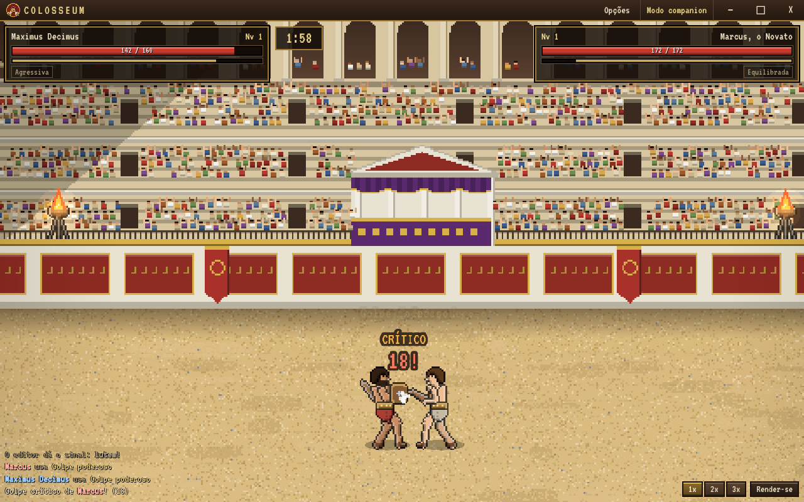

# COLOSSEUM — Desktop Gladiator RPG

RPG de progressão / auto-battler em **pixel art 16-bit**, ambientado na Roma Antiga.
Você desenvolve **um único gladiador** numa carreira permanente: treina, distribui atributos,
compra e equipa armas e proteções, escolhe a estratégia — e assiste às lutas, que acontecem
**automaticamente**, em tempo real, com animações e efeitos sonoros.

> Versão: **0.9.0** · Windows 10/11 · Português (Brasil) e inglês · Funciona offline.



## Destaques

- **Visual pintado** com pós-processamento em todas as cenas, público em silhueta, sangue nas lutas e um golpe final em câmera lenta com holofote.
- **Moradores que falam quando você clica neles**, móveis com colisão e falas na luta uma de cada vez.
- **Menu principal com 3 espaços de salvamento** separados e arte própria; o jogo abre em tela cheia e **Esc pausa**.
- **Eventos da cidade**: mercador viajante (a cada 6 a 10 dias), queda de braço na taverna (domingo à noite) e festival a cada 14 dias (arquibancada lotada, fama em dobro).
- **Torneio de sábado** às 14h, com inscrição antecipada e janela com a chave de 8 lutadores.
- **Rivais que lembram de você**: quem perdeu às vezes pede revanche e treina para ela; as falas mudam conforme a história de vocês.
- **Novos tipos de gladiador** (sempre corpo a corpo): dimachaerus, scissor, provocator e crupellarius, entre os desafiantes do dia.
- **Ferimentos** depois de nocaute ou desistência, curados dormindo, nas termas ou com o médico do ludus; **ferreiro** que melhora equipamentos até +3.
- **Chuva forte** com poças, respingos e relâmpagos; **luta cinematográfica** (câmera lenta e zoom no golpe final, público de pé); **retratos em pixel art** na arena, no torneio e no menu; balões de fala que não se sobrepõem.
- **Música** sintetizada (cidade, noite, taverna, arena e menu), com volume próprio e opção de desligar.
- **Cidade de Cápua com mapa**: Ludus, Alojamento, Mercado, Arena, Templo de Marte, Fórum, Termas e Taverna.
- **Dois idiomas**: português e inglês (no menu principal ou em Opções).
- **Sistema de dias**: dias da semana, relógio, energia, horários (mercado fecha à noite e aos domingos); durma para recuperar.
- **Clima**: dias de chuva com céu fechado, gotas caindo e som de chuva.
- **Árvore de habilidades** com três caminhos (Marte, Mercúrio e Minerva).
- **Jornal Cápua Times**: manchetes sobre sua carreira, fama e rivais toda manhã, com ilustrações em preto e branco.
- **Personalidade**: cada adversário tem jeito próprio de falar (balões de fala antes, durante e depois da luta); moradores, monge, taverneira e gladiadores do ludus também conversam.
- **Melhorias** compráveis: camas melhores (cochilo rende mais) e equipamentos do ludus (treino rende mais), visíveis nos cenários.
- Combate automático com distância, alcance, acerto, esquiva, bloqueio, cansaço, críticos e 4 habilidades; golpes, bloqueios, esquivas e reações bem visíveis.
- 3 estratégias, 6 atributos, nível até 30, 27 equipamentos visíveis no personagem.
- **5 anfiteatros** (um a cada dois adversários): Cápua, Pompeia, Verona, Leptis Magna e o Coliseu de Roma.
- **Ciclo de dia e noite** com céu, sol, lua, estrelas e braseiros que iluminam a arena à noite.
- **Efeitos sonoros** sintetizados: golpes, metal dos escudos, esquivas, corneta, público e fanfarras.
- **Tela cheia** ao abrir (F11 alterna para janela), interface com textos grandes e curtos.
- Salvamento automático com backup.

Detalhes em [docs/FUNCIONALIDADES.md](docs/FUNCIONALIDADES.md).

## Instalação (jogador)

Execute `Colosseum-Setup-0.9.0.exe` e abra o jogo pelo atalho. Há também a versão portátil
`Colosseum-Portatil-0.9.0.exe`. Veja [docs/INSTALACAO.md](docs/INSTALACAO.md).

## Desenvolvimento

```bash
npm install
```

```bash
npm run dev
```

Veja [docs/DESENVOLVIMENTO.md](docs/DESENVOLVIMENTO.md) e [docs/ARQUITETURA.md](docs/ARQUITETURA.md).

## Tecnologias

Electron 45 · Phaser 3.90 · TypeScript 5.9 · Vite 6 · Electron Builder 26 · Vitest 3 · Playwright.
Arte 100% própria, gerada por `tools/generate_assets.py`; sons sintetizados em tempo real (Web Audio).
Fontes VT323, Pixelify Sans, UnifrakturMaguntia e Old Standard TT (SIL Open Font License).
