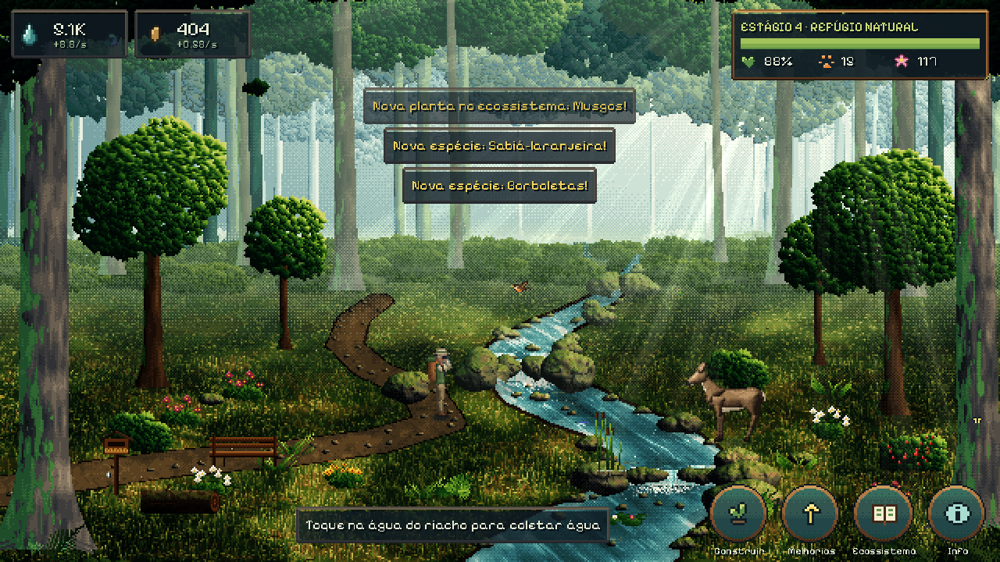
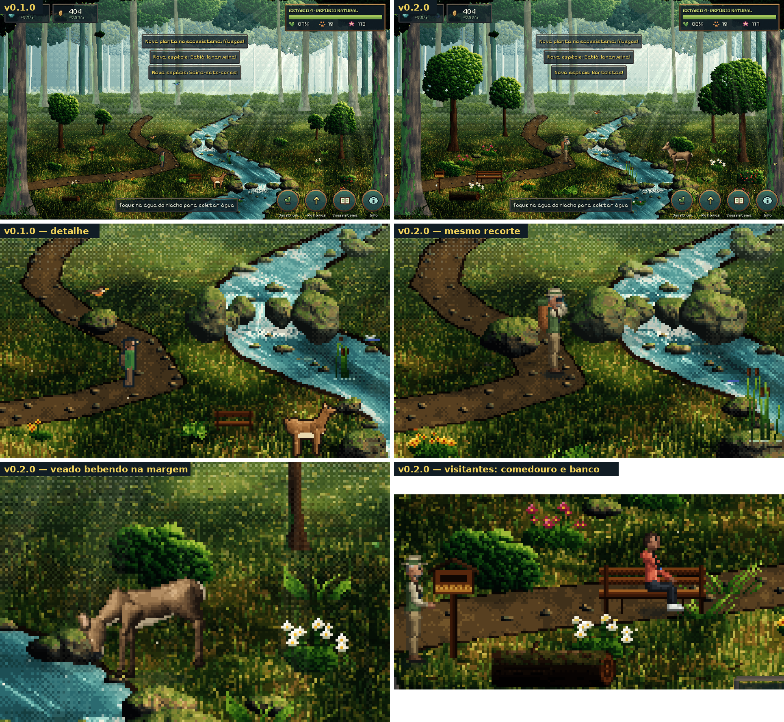
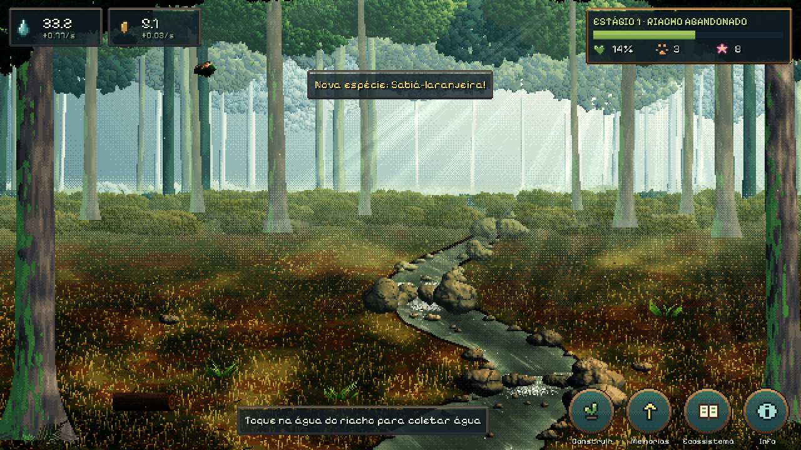
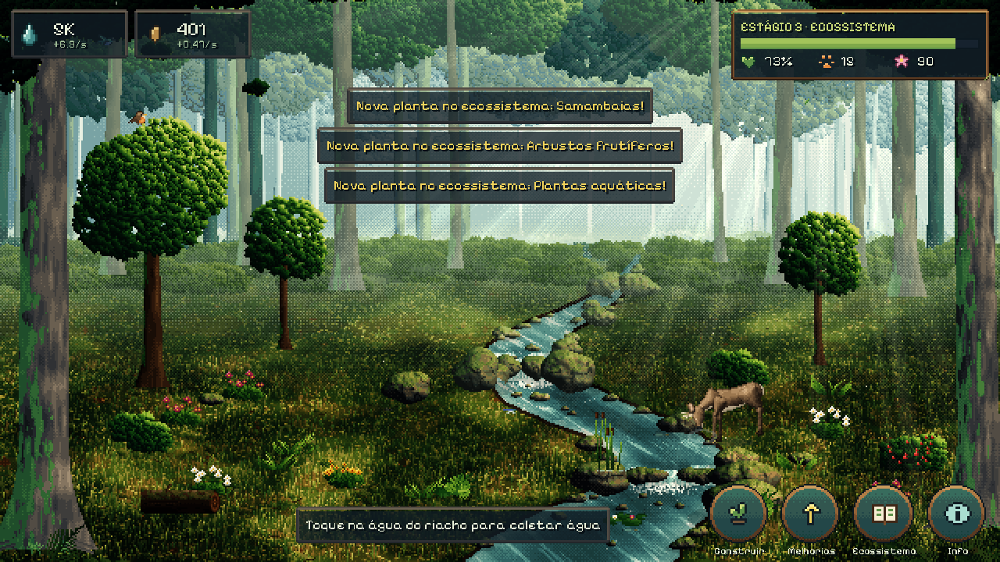
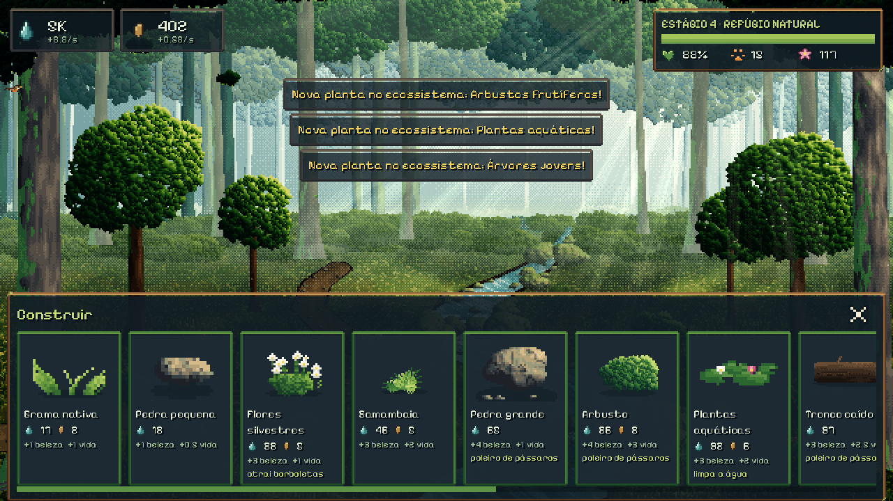
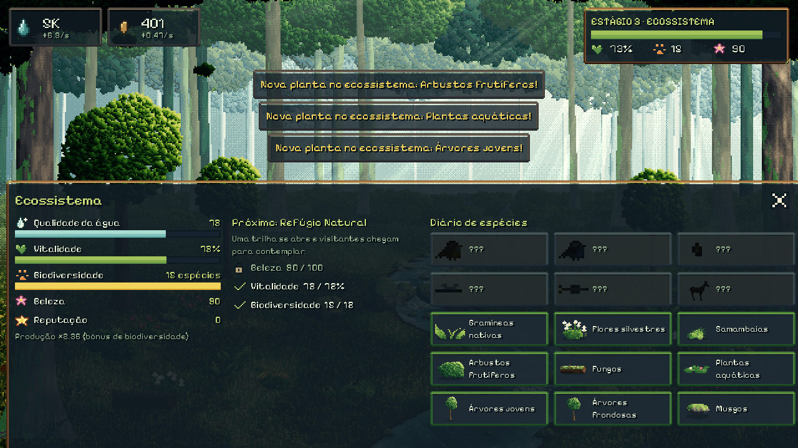

# Little Creek — protótipo mobile v0.2.0 (Godot 4.7)

Jogo de gerenciamento de ecossistema (semi-clicker + idle + simulação de
natureza) em pixel art de alta definição. Você recebe um riacho abandonado e o
transforma, aos poucos, num refúgio natural cheio de vida.



**Novidades da v0.2.0** (detalhes em [docs/CHANGELOG.md](docs/CHANGELOG.md)): veado e visitantes
refeitos com anatomia convincente e animações nas duas direções, e escala do mundo revisada
(vegetação, pedras e personagens proporcionais às árvores).



| Estágio 1 — Riacho Abandonado | Estágio 3 — Ecossistema |
|---|---|
|  |  |
| **Construir** | **Ecossistema** |
|  |  |

## Como abrir e jogar

1. Instale a **Godot 4.7** (estável, versão padrão — não precisa de .NET).
2. Abra a Godot → *Importar* → selecione `little-creek/project.godot`.
3. Pressione **F5**. No computador, o mouse simula o toque.

Android: instale o APK gerado (veja "Exportação Android"). Orientação
horizontal, 1280×720 de referência, adapta-se a 16:9, 20:9 e 4:3.

## O que está implementado (e testado)

| Sistema | Situação |
|---|---|
| Cenário em camadas (fundo enevoado, floresta média, chão, riacho, rochas, árvores-moldura, folhagem de primeiro plano) | ✅ |
| Água animada por shader (flow map em duas fases, cristas de luz, espuma, cascatas, brilho do sol, leito visível, turva → cristalina) | ✅ |
| Raios de sol volumétricos, névoa, partículas de poeira, pólen e folhas caindo, balanço das plantas com o vento | ✅ |
| Recursos: Água, Sementes, Vitalidade, Biodiversidade, Beleza (+ Qualidade da água e Reputação) | ✅ |
| Toque na água (coleta + respingo + som), produção passiva, 6 melhorias | ✅ |
| Construção com pré-visualização e validação por zonas (terra firme / dentro d'água / trilha), remoção com reembolso | ✅ 13 elementos |
| Fauna com comportamento: sabiá-laranjeira, saíra-sete-cores, borboletas, libélulas, lambaris, veado-catingueiro (macho e fêmea; anda, bebe, observa, orelhas, cauda, alerta, foge galopando) | ✅ 6 espécies |
| Visitantes (estágio 4): 3 personagens distintos; trilha, contemplar, sentar no banco, fotografar animais, alimentar pássaros, doações e reputação | ✅ |
| 4 estágios com mudanças visuais (chão "brota" em aglomerados, musgo nas pedras, água clareia, trilha aparece) | ✅ |
| HUD mobile, gaveta inferior (Construir, Melhorias, Ecossistema, Info), diário de espécies, dicas iniciais | ✅ |
| Áudio procedural: água, vento, cantos de pássaros, efeitos, música ambiente; volumes independentes | ✅ |
| Salvamento automático (20 s, ao pausar/sair), carregamento, progresso offline (60%, limite 2 h + 1 h por nível de Ciclo das chuvas) | ✅ |
| Exportação Android (APK assinado, arm64 + armv7) | ✅ gerado neste ambiente |

Testes automáticos (`-- --selftest`): toque na água pelo caminho real de
input, abrir menus, posicionar flores por toque, recusar flores na água,
plantas aquáticas na água, comprar melhoria, avançar de estágio, elegibilidade
da fauna, salvar/carregar, progresso offline, todas as animações do veado e dos
visitantes nas duas direções, ciclo completo do veado (chegar, beber, partir),
fuga ao toque e visitante percorrendo a trilha — **19/19 passando**.

> Não foi possível testar em um aparelho físico neste ambiente (sem
> dispositivo conectado). A renderização foi verificada com OpenGL por
> software (renderer *Compatibility*, o mesmo usado no Android).

## Controles

- **Tocar na água**: coleta água (às vezes uma semente).
- **Construir**: escolha um cartão → toque/arraste no cenário (fantasma verde
  = válido, vermelho = inválido) → solte para posicionar. Repita ou *Concluir*.
- **Tocar em animais**: interage (o pássaro canta e voa, o veado se assusta…).
- **Tocar nas copas / plantas**: o vento balança as folhas.
- **Info**: volumes de música e efeitos, *Velocidade do tempo ×1/×5/×20*
  (para testar a progressão rapidamente) e apagar progresso.

## Estrutura do projeto

```
little-creek/
  project.godot, export_presets.cfg
  scenes/Main.tscn             cena raiz (o resto é montado por código)
  scripts/
    autoload/                  GameData (JSON), GameState, SaveSystem, AudioManager
    systems/                   EcosystemRules (regras puras), WildlifeDirector, VisitorDirector
    world/                     World (camadas, consultas espaciais), PlacedItem
    creatures/                 Creature (base, animações direcionais, sombra) + Bird, Butterfly, Dragonfly, Fish, Deer, Visitor
    ui/                        UITheme, HUD, BuildPanel, UpgradePanel, EcoPanel, InfoPanel
    util/                      Palette, SpriteLib, NumFmt, DevTools, SelfTest
  shaders/                     water, dissolve, sway, light_rays, fog, reveal, underwater
  data/                        items, upgrades, species, stages (balanceamento)
                               creatures.json e scene_points.json (gerados com a arte)
  assets/sprites/{environment,vegetation,water,rocks,animals,humans,effects,ui}
  assets/audio/{music,ambience,sfx}, assets/fonts (Pixelify Sans, OFL)
  tools/art/*.py, tools/audio/gen_audio.py   geradores de todos os assets
                               (rig.py + creatures_deer.py + creatures_humans.py: personagens)
  docs/ART_DIRECTION.md, docs/GAME_DESIGN.md
```

## Pipeline de arte

Toda a arte é **pixel art gerada por código** a partir de uma paleta única
(`tools/art/palette.py`), seguindo `docs/ART_DIRECTION.md` (análise da imagem
de referência: densidade de pixels, paleta, luz, texturas). Para regenerar:

```bash
pip install numpy pillow scipy
python3 tools/art/gen_environment.py   # cenário, água, zonas, pontos do cenário
python3 tools/art/gen_props.py         # elementos construíveis
python3 tools/art/gen_creatures.py     # animais e visitantes (+ data/creatures.json; veado/humanos via rig.py, ~1 min)
python3 tools/art/gen_effects.py       # ruído, partículas, respingos
python3 tools/art/gen_ui.py            # painéis, botões, ícones
python3 tools/audio/gen_audio.py       # sons e música (precisa de ffmpeg com libvorbis)
```

`gen_environment.py` também gera `zones.png` (onde se pode construir) e
`data/scene_points.json` (poleiros, pontos onde o veado bebe, trilha, faixas
dos peixes), então arte e jogabilidade nunca saem de sincronia.

O mundo tem 800×360 pixels de arte (área segura 16:9 de 640×360) e é exibido
num `SubViewport` em escala inteira ×2 (×3 em telas 1080p), filtro *nearest*.

## Exportação Android

O APK deste protótipo foi gerado aqui com Godot 4.7.2, templates oficiais,
JDK 21 e `apksigner`/`zipalign`. Para gerar na sua máquina:

1. Godot 4.7 + *Editor → Gerenciar modelos de exportação → Baixar*.
2. Android SDK (Android Studio ou *command-line tools*) com `platform-tools` e
   `build-tools`; JDK 17+.
3. *Editor → Configurações do Editor → Exportar → Android*: caminhos do SDK e
   do JDK (a keystore de debug é criada automaticamente).
4. *Projeto → Exportar → Android → Exportar projeto* (`build/LittleCreek.apk`).

Para uma versão *release* assinada com sua própria chave:

```bash
keytool -genkeypair -keystore minha.keystore -alias littlecreek -keyalg RSA -keysize 2048 -validity 10000
export GODOT_ANDROID_KEYSTORE_RELEASE_PATH=$PWD/minha.keystore
export GODOT_ANDROID_KEYSTORE_RELEASE_USER=littlecreek
export GODOT_ANDROID_KEYSTORE_RELEASE_PASSWORD=...
godot --headless --path . --export-release "Android" build/LittleCreek.apk
```

Para instalar no celular: copie o APK e permita "instalar apps desconhecidos",
ou `adb install build/LittleCreek.apk`.

## Ferramentas de desenvolvimento

Argumentos após `--` (ex.: `godot --path . -- --state=stage4`):

- `--state=stage2|stage3|stage4` monta um ecossistema de demonstração (não salva).
- `--spawn=deer,visitor,fish,butterfly,dragonfly,sabia,saira` força aparições;
  `sitter`, `feeder`, `photo`, `look` forçam visitantes em cada atividade.
- `--seed=N` torna a cena de demonstração reproduzível (comparações antes/depois).
- `--ui=build|upgrades|eco|info` abre um painel.
- `--shot=arquivo.png --frames=N --quit` captura a tela.
- `--selftest --out=pasta` executa o teste automático.

## Próximos passos sugeridos

- Testar desempenho e legibilidade em aparelhos reais (alvo: 60 fps em
  intermediários; a água é um único shader por pixel em 800×360).
- Câmera com pan para expandir o cenário (o mundo já tem 800 px de largura).
- Ciclo dia/noite e clima (chuva já tem gancho no Ciclo das chuvas).
- Mais espécies (sapos, martim-pescador) e construções de contemplação.
- Trilha sonora gravada e efeitos com samples reais.
